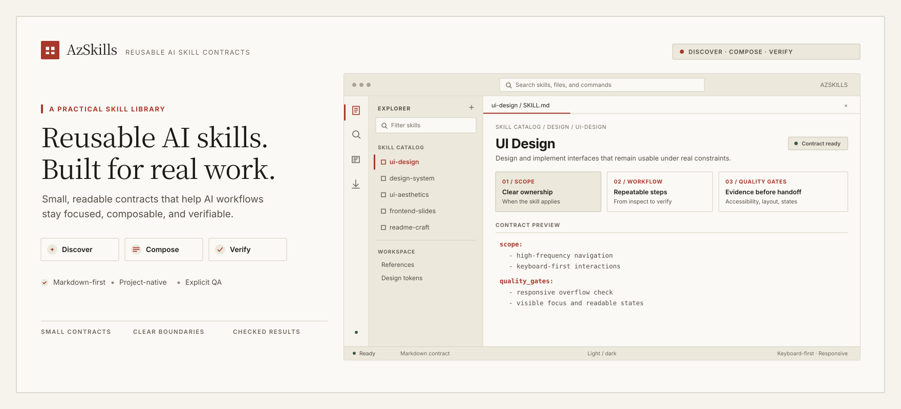
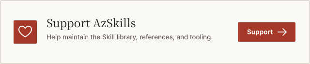

# AzSkills

<picture>
  <source media="(prefers-color-scheme: dark)" srcset="assets/azskills-hero-dark.svg">
  <source media="(prefers-color-scheme: light)" srcset="assets/azskills-hero.svg">
  
</picture>

Version **2.0.0**. One entry in your client, specialized capabilities inside.

AzSkills installs as a single `azskills` folder with one `SKILL.md`. Describe the result you want; the entry routes to the relevant internal module and loads only the necessary references. Internal module names are workflow choices, not additional skills to install.

## Install

Requires Node.js 22 or later. From this checkout:

```sh
node scripts/install-skills.mjs --tool codex --mode project --project /path/to/project --dry-run
node scripts/install-skills.mjs --tool codex --mode project --project /path/to/project --yes
```

The resulting entry is `/path/to/project/.agents/skills/azskills/SKILL.md`. Use `--mode user` for the client user directory, `--target <skills-root>` to override the destination, or `--list` to see supported clients. Running without arguments opens a client-selection prompt. The default scope is user. Every selection installs the same complete bundle.

For archive import, run `node scripts/package-skill.mjs --output /path/to/exports` and import `azskills.zip`. The ZIP has one root `SKILL.md` and all supporting files. Install the complete archive, not the manifest alone. Use a fresh export directory; pre-existing older archives are not removed automatically.

See [client integration guides](integrations/README.md) for native folders, manual import, and MCP configuration. Client discovery depends on the client scan scope and may require a restart. The installer verifies local contents separately from actual client discovery and invocation.

## Use

Ask naturally, for example:

- "Use AzSkills to review the architecture of this application."
- "Use AzSkills to refine the interface and check its states."
- "Use AzSkills to turn these findings into an HTML report."

You may specify `architecture/frontend` or a legacy name such as `frontend-architecture`. Both route within AzSkills. Read [routing](references/routing.md) for outcomes and modes; the [entry contract](SKILL.md) defines the loading sequence.

## Upgrade and rollback

The installer migrates entries recorded in an older `.azskills-manifest.json` to one `azskills` directory. It preserves unrelated paths and refuses an unmanaged conflicting `azskills` directory. An old manual installation without a manifest needs manual reconciliation after reviewing its files. Legacy `--skills <module>` and `--all-skills` options map to the complete bundle.

Backups live outside the scan root, in a sibling `.<skills-root-name>-azskills-backups` directory. Existing in-root AzSkills backups move there during migration so their old manifests cannot be rediscovered. Rollback restores the previous entries, previous manifest bytes, and previous in-root backup location, so it intentionally restores the previous discovery behavior too.

```sh
node scripts/install-skills.mjs --verify --target /path/to/skills
node scripts/install-skills.mjs --rollback --target /path/to/skills --yes
node scripts/install-skills.mjs --uninstall --target /path/to/skills --yes
```

Uninstall backs up and removes managed entries. Rollback restores the immediately preceding operation; an unchanged install preserves the existing rollback point. Backups are retained for recovery and are not automatically purged. A missing or modified rollback snapshot requires manual recovery; legacy rollback records use the previous installer.

## Internal modules

These contracts are ordinary Markdown files. They retain their domain workflows and output gates.

<!-- SKILL-CATALOG:START -->
| Family | Module | Modes | Focus |
| :--- | :--- | :--- | :--- |
| Architecture | [`architecture`](references/modules/architecture.md) | runtime, frontend, migration, review | Runtime, frontend stack, persistence, and process boundaries. |
| Interface | [`design-system`](references/modules/design-system.md) | ingest, author, migrate, audit | DESIGN.md ingestion, normalization, provenance, and verification. |
| Interface | [`ui-design`](references/modules/ui-design.md) | build, refine, review, system | Interface hierarchy, components, states, responsive behavior, and visual QA. |
| Interface | [`ui-motion`](references/modules/ui-motion.md) | build, review, audit, pattern, svg | Motion construction, review, audit, patterns, and SVG animation. |
| Visual | [`logo-generator`](references/modules/logo-generator.md) | mark, character, system | Logos, product marks, character marks, and identity systems. |
| Visual | [`photo-abstract-editorial`](references/modules/photo-abstract-editorial.md) | treatment, audit | Photograph-preserving abstract editorial diptychs. |
| Production | [`frontend-slides`](references/modules/frontend-slides.md) | new, convert, enhance, report | Responsive HTML reports, fixed-stage presentations, and rendered QA. |
| Production | [`remotion-production`](references/modules/remotion-production.md) | video, data, 3d, ui-showcase, motion, av | Deterministic programmatic video and render delivery. |
| Publishing | [`readme-craft`](references/modules/readme-craft.md) | build, rewrite, audit | GitHub README architecture, visuals, links, and QA. |
| Publishing | [`steam-mod-page`](references/modules/steam-mod-page.md) | player, developer, audit | Steam Workshop BBCode pages and bilingual delivery. |
| Publishing | [`localization`](references/modules/localization.md) | translate, audit | Game CSV localization with locale completeness and markup safety. |
| Career | [`resume-evidence-workflow`](references/modules/resume-evidence-workflow.md) | evidence, tailor, review | Career evidence, requirement alignment, and editable resume delivery. |
| Operations | [`tool-integration`](references/modules/tool-integration.md) | install, configure, troubleshoot, remove | Connect AzSkills to AI clients with verified installation and setup workflows. |
<!-- SKILL-CATALOG:END -->

## Legacy names

<!-- SKILL-ALIASES:START -->
| Alias | Module | Mode |
| :--- | :--- | :--- |
| `application-architecture` | [`architecture`](references/modules/architecture.md) | runtime |
| `frontend-architecture` | [`architecture`](references/modules/architecture.md) | frontend |
| `ui-aesthetics` | [`ui-design`](references/modules/ui-design.md) | refine |
| `ui-ux-design-intelligence` | [`ui-design`](references/modules/ui-design.md) | review |
| `ui-motion-review` | [`ui-motion`](references/modules/ui-motion.md) | review |
| `ui-motion-audit` | [`ui-motion`](references/modules/ui-motion.md) | audit |
| `rare-ui-motion` | [`ui-motion`](references/modules/ui-motion.md) | pattern |
| `svg-animation` | [`ui-motion`](references/modules/ui-motion.md) | svg |
| `ip-as-logo` | [`logo-generator`](references/modules/logo-generator.md) | character |
| `l13n` | [`localization`](references/modules/localization.md) | translate |
<!-- SKILL-ALIASES:END -->

## MCP

Register `node scripts/azskills-mcp.mjs` as a stdio server named `azskills`. It lists one tool and one public resource. Call `azskills` with `action: entry` to start, `route` for the routing table, `module` plus `id` (optionally `mode`) for one contract, or `file` plus a bundle-relative `path` for supporting content. Paths are matched against packaged files; arbitrary filesystem access is unavailable. Binary files return embedded resources. Supporting resource URIs use `azskills://skills/azskills/<encoded/path>`.

## Contributing and verification

See [module system](SKILL-SYSTEM.md), [design contract](DESIGN.md), [design intelligence](design-intelligence.md), [migration and version plan](docs/single-entry-migration.md), and [third-party notices](THIRD_PARTY_NOTICES.md). License: [MIT](LICENSE).

```sh
node scripts/generate-routing.mjs --check
node scripts/validate-skills.mjs
node scripts/validate-integrations.mjs
node scripts/test-package-skill.mjs
node scripts/test-install-skills.mjs
node scripts/test-azskills-mcp.mjs
node design-system/tui/preview.mjs --check
```

The terminal preview is an internal module catalog for contributors; it is not the client skill panel.

Report bugs or propose module improvements through the repository issue templates. Keep one public entry, version changed contracts, and verify portable links and migration behavior before submitting changes.

## Support

Support maintenance of the internal modules, references, and tooling.

[Support AzSkills](https://cyojkoy.github.io/Payment/)

<a href="https://cyojkoy.github.io/Payment/">
  <picture>
    <source media="(prefers-color-scheme: dark)" srcset="assets/readme/support-cta-dark.svg">
    <source media="(prefers-color-scheme: light)" srcset="assets/readme/support-cta.svg">
    
  </picture>
</a>
