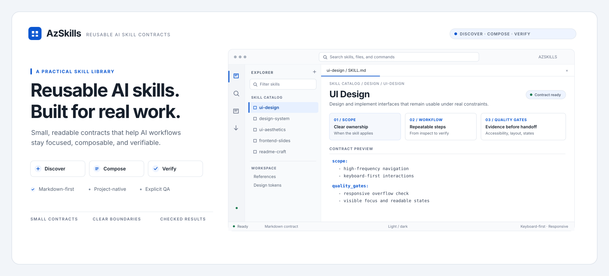
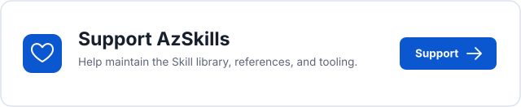

# AzSkills

<div align="center">

<picture>
  <source media="(prefers-color-scheme: dark)" srcset="assets/azskills-hero-dark.svg">
  <source media="(prefers-color-scheme: light)" srcset="assets/azskills-hero.svg">
  
</picture>

**Reusable AI Skills for real work.**

Repository-local `SKILL.md` behavior contracts for engineering, architecture, frontend systems, design systems, UI quality, presentations, documentation, localization, translation, and visual production.

The repository-owned UI contract is documented in [`DESIGN.md`](DESIGN.md): a practical, VSCodium-inspired workbench model focused on compact navigation, discoverable search, technical-content readability, keyboard-first interaction, accessible states, responsive layout, and light/dark themes. The same contract has a terminal target: cell-based layout, ANSI semantic roles, ASCII fallbacks, and plain mode for logs and screen readers.

<p>
  
  
  
  
  <a href="https://github.com/CYoJkoY/AzSkills/stargazers"></a>
</p>

<p>
  <a href="#readme-overview">Overview</a> ·
  <a href="#readme-architecture">Architecture</a> ·
  <a href="#readme-design-system">Design system</a> ·
  <a href="#readme-skills">Skills</a> ·
  <a href="#readme-choose">Choose</a> ·
  <a href="#readme-usage">Use</a> ·
  <a href="#readme-quality">Quality</a> ·
  <a href="#readme-contributing">Contribute</a> ·
  <a href="#readme-support">Support</a>
</p>

</div>

---

<a name="readme-overview"></a>
##  Overview

AzSkills is a **modular library of reusable AI behavior contracts**.

A Skill is not a framework, runtime, agent platform, or application. It is a human-readable `SKILL.md` that defines a bounded capability with explicit rules for activation, execution, verification, and output.

The core model is deliberately small:

```text
request
  -> family
    -> one canonical Skill
      -> one mode
        -> named references
          -> execute
            -> quality gates
              -> artifact + evidence
```

### Why behavior contracts?

Prompt fragments are easy to copy and hard to maintain. A Skill makes the important parts explicit:

| Contract element | Purpose |
| :--- | :--- |
| **Family** | Groups related capabilities without merging their responsibilities. |
| **Contract** | Names applicability, ownership, inputs, outputs, composition, and gates. |
| **Modes** | Changes the workflow and gates inside one owner. |
| **Workflow** | Turns experience into a repeatable execution sequence. |
| **Quality gates** | Defines what must be verified before work is considered complete. |
| **Output contract** | Defines the expected artifact or response shape. |
| **References** | Supplies depth without creating a hidden second contract. |

AzSkills therefore favors **small responsibilities, composition, repository-native context, explicit verification, and maintainability** over one giant universal prompt.

---

<a name="readme-architecture"></a>
##  Architecture

AzSkills separates **shared rules**, **canonical contracts**, **modes**, and
**references**. The registry is the source of truth; the README and aliases are
checked against it.

```text
SKILL-SYSTEM.md          shared rules and contract template
    |
skills.json              canonical owners, modes, aliases, families
    |
<skill>/SKILL.md         one decision class, at most 280 lines
    |
<skill>/references/      depth loaded only when the mode names it
    |
CI                       registry, frontmatter, budgets, links, catalog parity
```

A caller may still use an old path. The alias forwards to one canonical Skill and
one mode; it cannot add rules.


### Shared reasoning layer

[`design-intelligence.md`](design-intelligence.md) is **not a Skill**. It is a visual extension layer for typography, color, composition, and visual QA.

It is intentionally separate from implementation Skills so the same visual reasoning is not duplicated across UI, presentation, identity, and documentation workflows.

### DESIGN.md integration

[`design-system`](design-system/SKILL.md) is the boundary between external design-system documents and AzSkills.

It supports three source forms:

| Source form | Interpretation |
| :--- | :--- |
| **Token-bearing** | Machine-readable values are treated as exact source values; prose supplies intent and usage. |
| **Prose-first** | Explicit values are retained as `verified-prose` evidence; missing tokens are never fabricated. |
| **Mixed** | Token values supply exact data; prose supplies behavior, rationale, states, and responsive guidance. |

The adapter then normalizes those sources into:

```text
Context
  ->
Primitive
  ->
Semantic
  ->
Component
  ->
State
  ->
Responsive / Accessibility / Motion / QA
```

Multiple design references remain a **reference corpus**, not a system to average together. Source authority, inferred values, implementation choices, and unresolved assumptions are kept explicit.

See:

- [DESIGN.md adapter](design-system/references/design-md-adapter.md)
- [DESIGN.md schema reference](design-system/references/design-md-schema.md)
- [Source format matrix](design-system/references/source-format-matrix.md)

---

<a name="readme-design-system"></a>
##  Design system

AzSkills uses a **practical, workbench-oriented contract for interactive product UI**. The system takes cues from VSCodium / VS Code workbench conventions—compact navigation, content-first layout, search-led discovery, explicit selection and focus states, useful density, and keyboard access—without copying product branding or proprietary assets. It is a functional direction, not a mandatory visual skin for every artifact: README illustrations, logos, editorial documents, and slide decks should use an art direction suited to their content while respecting the repository’s accessibility and quality requirements.

The workbench layer is the default. The washi editorial layer is opt-in: set `data-surface="editorial"` on the `<html>` root of a standalone reading document. A surface that relied on the older washi defaults needs that attribute to keep its treatment.

Executable artifacts, all referenced by the contract in [`DESIGN.md`](DESIGN.md):

| Artifact | Role |
| :--- | :--- |
| [`design-system/wabi-press.css`](design-system/wabi-press.css) | Existing stylesheet entry point, retained at its historical path; includes the current `--wb-*` workbench tokens and primitives alongside compatibility rules. `DESIGN.md` defines the current interface contract. |
| [`design-system/wabi-press-theme.ts`](design-system/wabi-press-theme.ts) | Existing native TypeScript theme controller for explicit light/dark choice and system `prefers-color-scheme` behavior. The filename is retained for compatibility. |
| [`design-system/preview/index.html`](design-system/preview/index.html) | Dependency-free workbench preview for skill navigation/search, selection states, theme switching, density modes, and responsive layout. |
| [`design-system/tui/preview.mjs`](design-system/tui/preview.mjs) | Dependency-free terminal preview for 24-240 columns (CI matrix 40-160), truecolor/256/16/plain modes, keyboard states, and a `--check` conformance gate used by CI. |

---

<a name="readme-skills"></a>
##  Skill catalog

The registry defines canonical Skills in six families. Choose one canonical owner,
then choose a mode. Deep detail lives in references and does not expand the owner.

The assembly rules are in [`SKILL-SYSTEM.md`](SKILL-SYSTEM.md); the machine-readable
registry is [`skills.json`](skills.json).

<!-- SKILL-CATALOG:START -->
| Family | Canonical Skill | Modes | Focus |
| :--- | :--- | :--- | :--- |
| Core | [`ultrathink`](ultrathink/SKILL.md) | deep, rescue | Assumptions, alternatives, failure analysis, and the decision record. |
| Architecture | [`architecture`](architecture/SKILL.md) | runtime, frontend, migration, review | Runtime, stack, persistence, and process boundaries. |
| Interface | [`design-system`](design-system/SKILL.md) | ingest, author, migrate, audit | DESIGN.md evidence, tokens, semantics, provenance, and QA. |
| Interface | [`ui-design`](ui-design/SKILL.md) | build, refine, review, system | Interface hierarchy, components, states, responsive behavior, and visual QA. |
| Interface | [`ui-motion`](ui-motion/SKILL.md) | build, review, audit, pattern, svg | Motion construction, review, audit, expressive patterns, and SVG. |
| Visual | [`logo-generator`](logo-generator/SKILL.md) | mark, character, system | Logos, product marks, character marks, and identity systems. |
| Visual | [`photo-abstract-editorial`](photo-abstract-editorial/SKILL.md) | treatment, audit | Photograph-preserving abstract editorial diptychs. |
| Production | [`frontend-slides`](frontend-slides/SKILL.md) | new, convert, enhance | Fixed-stage 1920x1080 HTML presentations. |
| Production | [`remotion-production`](remotion-production/SKILL.md) | video, data, 3d, ui-showcase, motion, av | Deterministic programmatic video and render delivery. |
| Publishing | [`readme-craft`](readme-craft/SKILL.md) | build, rewrite, audit | GitHub README architecture, visuals, links, and QA. |
| Publishing | [`steam-mod-page`](steam-mod-page/SKILL.md) | player, developer, audit | Steam Workshop BBCode pages and bilingual delivery. |
| Publishing | [`localization`](localization/SKILL.md) | translate, audit | Game CSV localization with locale and markup safety. |
<!-- SKILL-CATALOG:END -->

### Compatibility aliases

Old paths still work. Each alias points to one canonical Skill and one mode; it
does not own rules.

<!-- SKILL-ALIASES:START -->
| Alias | Canonical | Mode |
| :--- | :--- | :--- |
| `application-architecture` | [`architecture`](architecture/SKILL.md) | runtime |
| `frontend-architecture` | [`architecture`](architecture/SKILL.md) | frontend |
| `ui-aesthetics` | [`ui-design`](ui-design/SKILL.md) | refine |
| `ui-ux-design-intelligence` | [`ui-design`](ui-design/SKILL.md) | review |
| `ui-motion-review` | [`ui-motion`](ui-motion/SKILL.md) | review |
| `ui-motion-audit` | [`ui-motion`](ui-motion/SKILL.md) | audit |
| `rare-ui-motion` | [`ui-motion`](ui-motion/SKILL.md) | pattern |
| `svg-animation` | [`ui-motion`](ui-motion/SKILL.md) | svg |
| `ip-as-logo` | [`logo-generator`](logo-generator/SKILL.md) | character |
| `l13n` | [`localization`](localization/SKILL.md) | translate |
<!-- SKILL-ALIASES:END -->

### Shared design reasoning

[`design-intelligence.md`](design-intelligence.md) is a visual extension layer, not
a Skill. It supplies only visual judgment shared by visual Skills.

---

<a name="readme-choose"></a>
##  Choose a Skill

Use this routing map as the first decision point:

```text
What are you doing?
|
+-- Runtime, stack, persistence, boundaries --> architecture
|     +-- runtime | frontend | migration | review
|
+-- Consume or author DESIGN.md ---------------> design-system
|     +-- ingest | author | migrate | audit
|
+-- Build or change an interface --------------> ui-design
|     +-- build | refine | review | system
|
+-- Add, review, audit, or adapt motion -------> ui-motion
|     +-- build | review | audit | pattern | svg
|
+-- Create a logo or character mark -----------> logo-generator
|     +-- mark | character | system
|
+-- Treat one photograph ---------------------> photo-abstract-editorial
|     +-- treatment | audit
|
+-- Create an HTML deck ----------------------> frontend-slides
|     +-- new | convert | enhance
|
+-- Create a rendered video ------------------> remotion-production
|     +-- video | data | 3d | ui-showcase | motion | av
|
+-- Write a GitHub README ---------------------> readme-craft
+-- Write a Steam Workshop page ---------------> steam-mod-page
+-- Translate a game CSV ----------------------> localization
+-- Difficult or high-risk reasoning ----------> ultrathink + domain Skill
```

### Composition rules

```text
New domain behavior    -> new canonical Skill
Narrow variation       -> mode inside an existing Skill
Reusable depth         -> reference inside the owning Skill
Cross-artifact rule    -> shared rule in SKILL-SYSTEM.md
DESIGN.md ingestion    -> design-system
Deep reasoning         -> ultrathink + one owning domain Skill
Runtime decision       -> architecture before downstream UI choices
```

Do not duplicate a shared rule merely to make a Skill look self-contained. An
alias forwards; it does not add a second contract.

---

<a name="readme-usage"></a>
##  Use

AzSkills is runtime-agnostic. There is no repository-wide application to install; the deliverable is the Markdown contract itself plus any supporting references or assets.

### 1. Clone

```bash
git clone https://github.com/CYoJkoY/AzSkills.git
cd AzSkills
```

For AzSkills-owned interactive UI, follow [`DESIGN.md`](DESIGN.md) and use the workbench tokens and primitives in [`design-system/wabi-press.css`](design-system/wabi-press.css); its historical filename is retained for compatibility. Do not force an application workbench onto slide decks, logos, editorial documents, or README illustrations. For those outputs—and for external product work without an authoritative local direction—use the visual judgment in [`design-intelligence.md`](design-intelligence.md).

### 2. Select the narrowest Skill

Start with the smallest capability that fully owns the requested work.

For example:

```text
New application
   -> architecture (runtime)
   -> architecture (frontend)
   -> ui-design (build)
```

Or:

```text
DESIGN.md + UI implementation
   -> design-system (ingest)
   -> ui-design (build)
   -> ui-design (refine) when visual polish is needed
```

For difficult work:

```text
ultrathink (deep)
   + one canonical owner
```

### 3. Read the contract and its references

The contract is always the Skill directory's `SKILL.md`. Some Skills also contain reference documents, templates, assets, or specialized implementation guides.

Do not assume a reference file is globally applicable. Read it only when the owning Skill points to it or the task requires it.

### 4. Execute with repository context

Inspect the real project before implementing:

```text
repository
  ->
existing architecture
  ->
existing conventions / identity
  ->
active Skill contract
  ->
task-specific changes
```

Preserve project-native APIs, configuration keys, defaults, component systems, and user-visible behavior unless the task explicitly changes them.

### 5. Verify before returning the result

The standard loop is:

```text
inspect
  ->
plan
  ->
implement
  ->
render / test
  ->
inspect again
  ->
correct
  ->
verify
```

For design-system work, verify both the source mapping and the rendered result.

---

<a name="readme-quality"></a>
##  Quality bar

AzSkills is intentionally evidence-first.

**Repository truth.** Do not invent features, benchmarks, screenshots, compatibility, versions, URLs, or destinations.

**Explicit behavior.** A Skill should define scope, constraints, workflow, quality gates, and output expectations.

**Project-native context.** Inspect the real repository before making architecture, UI, documentation, or visual decisions.

**Composition over duplication.** Shared behavior belongs in shared references; distinct behavior belongs in focused Skills.

**Design-system integrity.** Preserve exact source tokens, distinguish inference from fact, and never blend unrelated brand systems without an explicit synthesis requirement.

**Visual verification.** Authored SVGs, interfaces, and presentations should be inspected at realistic display sizes with attention to geometry, spacing, typography, themes, accessibility, and interaction states.

**Stable navigation.** Manually authored README navigation should use explicit custom anchors rather than guessed GitHub fragments.

**Searchable documentation.** Installation, configuration, limitations, legal information, important links, and canonical support destinations belong in searchable Markdown or normal HTML.

**Dynamic facts.** Repository-generated facts such as the Skill count should come from automation rather than becoming stale hardcoded prose.

### CI quality gates

[`validate-skills.yml`](.github/workflows/validate-skills.yml) checks the registry,
contract blocks, line budgets, aliases, links, and catalog parity. The DESIGN.md
and motion contracts have their own workflows. [`update-skill-badge.yml`](.github/workflows/update-skill-badge.yml)
counts canonical Skills from `skills.json`, not every directory.

---

<a name="readme-repository"></a>
##  Repository map

```text
AzSkills/
├── .github/
│   ├── ISSUE_TEMPLATE/
│   │   ├── bug_report.yml
│   │   ├── config.yml
│   │   ├── documentation.yml
│   │   ├── new_skill.yml
│   │   └── skill_improvement.yml
│   ├── badges/
│   │   └── skills.json
│   └── workflows/
│       ├── update-skill-badge.yml
│       ├── validate-design-contract.yml
│       ├── validate-remotion-production-contract.yml
│       ├── validate-motion-contract.yml
│       └── validate-skills.yml
│
├── assets/
│   ├── azskills-hero.svg
│   ├── azskills-hero-dark.svg
│   └── readme/
│       ├── icons/
│       ├── support-cta.svg
│       └── support-cta-dark.svg
│
├── architecture/
│   ├── SKILL.md
│   └── references/
├── design-system/
│   ├── SKILL.md
│   ├── wabi-press.css
│   ├── wabi-press-theme.ts
│   ├── preview/
│   ├── tui/
│   └── references/
├── localization/
│   └── SKILL.md
├── logo-generator/
│   ├── SKILL.md
│   └── references/
├── photo-abstract-editorial/
│   └── SKILL.md
├── frontend-slides/
│   ├── DESIGN_SYSTEM.md
│   ├── STYLE_PRESETS.md
│   ├── animation-patterns.md
│   ├── html-template.md
│   ├── scripts/
│   ├── viewport-base.css
│   └── references/
├── remotion-production/
│   ├── SKILL.md
│   └── references/
├── readme-craft/
│   ├── SKILL.md
│   └── references/
├── steam-mod-page/
│   ├── SKILL.md
│   └── references/
├── ui-design/
│   ├── SKILL.md
│   └── references/
├── ui-motion/
│   ├── SKILL.md
│   └── references/
├── ultrathink/
│   ├── SKILL.md
│   └── references/
│
├── application-architecture/   # alias -> architecture/runtime
├── frontend-architecture/      # alias -> architecture/frontend
├── ui-aesthetics/              # alias -> ui-design/refine
├── ui-ux-design-intelligence/  # alias -> ui-design/review
├── ui-motion-review/           # alias -> ui-motion/review
├── ui-motion-audit/            # alias -> ui-motion/audit
├── rare-ui-motion/             # alias -> ui-motion/pattern
├── svg-animation/              # alias -> ui-motion/svg
├── ip-as-logo/                 # alias -> logo-generator/character
├── l13n/                       # alias -> localization/translate
│
├── scripts/
│   └── validate-skills.mjs
├── skills.json
├── SKILL-SYSTEM.md
├── DESIGN.md
├── design-intelligence.md
├── THIRD_PARTY_NOTICES.md
├── LICENSE
└── README.md
```

---

<a name="readme-contributing"></a>
##  Contributing

Good contributions add a clear capability, improve an existing workflow, fix a concrete defect, or remove unnecessary complexity.

Before creating a new Skill:

1. Check whether the behavior belongs in an existing Skill as a mode.
2. Check whether it is a cross-Skill rule for [`SKILL-SYSTEM.md`](SKILL-SYSTEM.md) or visual judgment for [`design-intelligence.md`](design-intelligence.md).
3. Register the canonical Skill or alias in [`skills.json`](skills.json).
4. Use the contract template; keep the canonical file at or below 280 lines.
5. Put depth in a reference and link it from `## References`.
6. Record provenance and licensing in [`THIRD_PARTY_NOTICES.md`](THIRD_PARTY_NOTICES.md).
7. Run `node scripts/validate-skills.mjs` before opening the PR.

For Skill proposals and improvements, use the repository's structured [Issue Forms](https://github.com/CYoJkoY/AzSkills/issues/new/choose).

---

<a name="readme-support"></a>
##  Support

AzSkills is maintained as an open collection of reusable engineering, design, documentation, localization, translation, and visual workflows. Support helps sustain the time required to maintain the Skills, references, assets, and repository infrastructure.

<div align="center">

<a href="https://cyojkoy.github.io/Payment/">
  <picture>
    <source media="(prefers-color-scheme: dark)" srcset="assets/readme/support-cta-dark.svg">
    <source media="(prefers-color-scheme: light)" srcset="assets/readme/support-cta.svg">
    
  </picture>
</a>

**Direct support link:** https://cyojkoy.github.io/Payment/

<sub>The support CTA is authored for AzSkills and links directly to the project's support destination.</sub>

</div>

---

<a name="readme-license"></a>
##  License & provenance

AzSkills is released under the [MIT License](LICENSE).

Some Skills incorporate or adapt ideas from public upstream projects and methodologies. Sources and applicable notices are documented in [`THIRD_PARTY_NOTICES.md`](THIRD_PARTY_NOTICES.md).

Integrated Skills are rewritten to fit AzSkills' architecture rather than mechanically vendoring unrelated upstream repositories.
